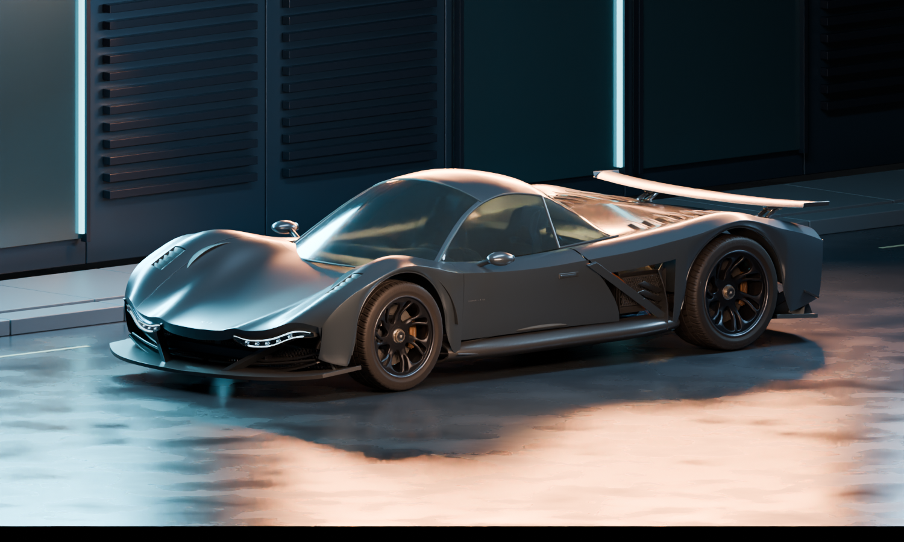

# GPT-6.2 3D Showcase

Exploring the limits of OpenAI's 6.2 model family in 3D modeling.

This repository contains a collection of my experiments with Sol 6.2 and Astra 6.2, creating complex, fully editable 3D assets entirely through code in Blender.

I've spent many hours experimenting with different prompts, agent configurations, and modeling workflows to see how far these models can go.

## Tools & Workflow

- **GPT** for writing, refining, and experimenting with prompts and agent instructions.
- **Codex** for the agentic harness used to execute the modeling tasks.
- **Blender MCP** for allowing agents to interact with Blender, inspect scenes, and verify their work.
- **Blender Python API** for procedural geometry, materials, lighting, animation, and rendering.
- **Subagents** for specialized agents for modeling individual components, technical analysis, and quality control in some experiments.

## About the Experiments

Each model started with a single initial modeling prompt. Some experiments used specialized subagents, while others were completed by a single agent.

Generation times ranged from approximately 22 to 43 minutes per main asset, excluding the time I spent developing and refining the prompts and the earlier generation of the hypercar's wheel.

The hypercar reused a wheel previously generated by Astra 6.2 High.

This is not a formal benchmark, but a showcase of what's possible with the right prompts, tools, and agentic workflows.

All the prompts, renders, editable Blender projects, and available GLB exports are included so you can explore the results and experiment yourself.

## Model Statistics

| Asset | Model | Subagents (Sol High) | Time | Objects | Triangles |
|---|---|---:|---:|---:|---:|
| [Hypercar](hypercar/) | Astra 6.2 High | 2 | 43 min | 6,886 | 13,815,380 |
| [Medieval Helmet](medieval-helmet/) | Sol 6.2 Ultra | 3 | 27 min | 192 | 298,524 |
| [Crystal Heart](crystal-heart/) | Sol 6.2 High | 0 | 22 min | 279 | 61,796 |
| [Robotic Arm](robotic-arm/) | Sol 6.2 High | 0 | 30 min | 1,565 | 1,646,814 |
| [Tractor](tractor/) | Sol 6.2 Ultra | 4 | 33 min | 3,723 | 2,136,501 |
| [Wheel Assembly](hypercar/) | Astra 6.2 High | 2 | 41 min | 225 | 2,467,305 |

*Generation times exclude prompt development and subsequent
showcase requests. Hypercar generation time excludes the
previously generated wheel.*

*Object counts refer to the assets rather than the entire
Blender scenes. Triangle counts include evaluated modifiers
and converted geometry, excluding separately counted instances.*
